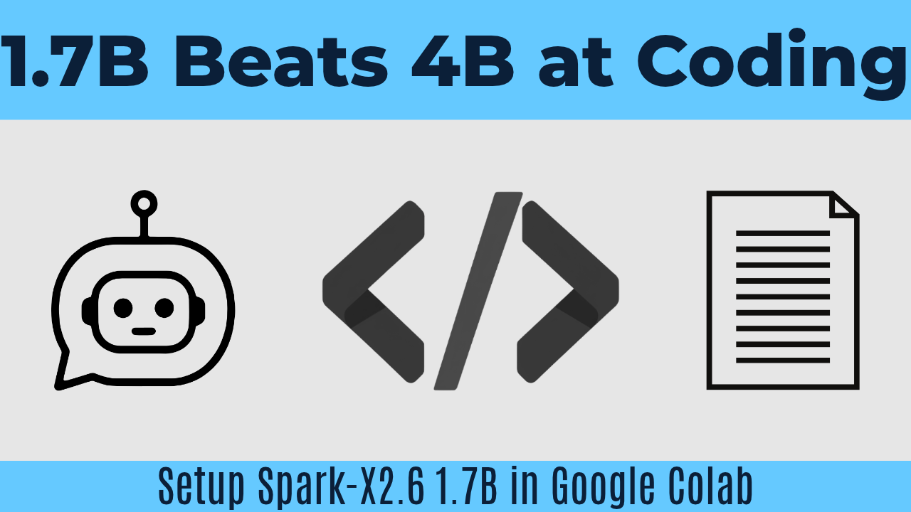

# ⚡ Spark-X2.6 1.7B in Google Colab

This repository contains a simple, interactive Google Colab notebook for running the **Spark-X2.6-1.7B** language model. This notebook allows you to easily chat with the AI, utilize its advanced "thinking" modes, and see the text stream in real time, all running locally on a free Google Colab T4 GPU.

**🎥 Watch the Tutorial:** [How to Use](https://www.youtube.com/watch?v=_CyOUbm-bR0)

**🚀 Run in Colab:** [Open Google Colab Notebook](https://colab.research.google.com/drive/1kRytdn-pNhL4Lk12xuJxcIzKwLWZQ83v?usp=sharing)

---

## ✨ Features Supported in this Notebook

This notebook automates the setup of the Spark-X2.6 model into 3 simple cells:

*   **⚙️ Initialize Core Environment**: Installs the required `transformers` library and enables `hf_transfer` for ultra-fast model downloads.
*   **📥 Download and Load Model**: Fetches the `Spark-X2.6-1.7B` model using optimized fp16 precision to ensure it runs smoothly and avoids bfloat16 errors on older Colab T4 GPUs.
*   **💬 Spark-X2.6 Text Generation**:
    *   **Text Streaming**: Uses `TextIteratorStreamer` to display the AI's response word-by-word as it generates, just like ChatGPT.
    *   **Advanced Reasoning**: Toggle `USE_THINKING` to enable the model's reasoning mode, and choose between `low` or `high` reasoning effort.
    *   **Parameter Controls**: Easily adjust `MAX_NEW_TOKENS`, `REPETITION_PENALTY`, and `TEMPERATURE` using sliders.

## 🛠️ How to Use

1.  Click the "Open in Colab" badge above.
2.  Go to **Runtime > Change runtime type** and ensure the **T4 GPU** is selected.
3.  Run **Cell 1** to install the required libraries.
4.  Run **Cell 2** to rapidly download and load the model into the GPU memory.
5.  Go to **Cell 3**. Type your prompt (e.g., "What is the capital of Germany?"), choose whether you want the AI to use its "thinking" mode, and click Play. You can run this cell as many times as you want to keep asking new questions!

## 🤝 Credits

*   **Notebook Creator:** [@CoinNoin](https://www.youtube.com/@CoinNoin)
*   **Base Model:** [XHToken / Spark-X2.6-1.7B](https://huggingface.co/XHToken/Spark-X2.6-1.7B)
